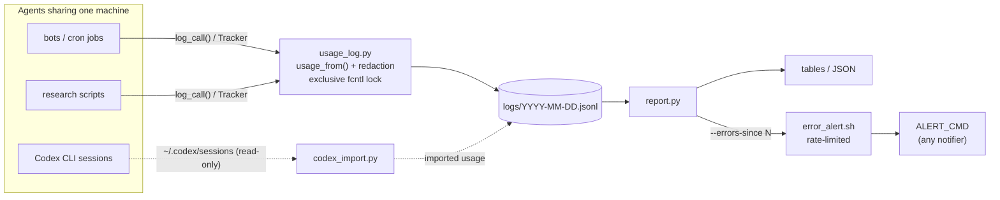

<div align="center">

# 📒 agent-usage-ledger

**LLM/API 呼び出しをエージェントごとに記録する、小さな共有台帳。誰が何を呼び出し、何トークン使い、何が失敗したかがわかります。**

[](https://github.com/sdpwh7-ux/agent-usage-ledger/actions/workflows/ci.yml)
[](LICENSE)
[](https://www.python.org/)
[](#-特長)
[](#-セキュリティモデル)

[English](README.md) | [简体中文](README.zh-CN.md) | **日本語**

</div>

---

## 🤔 なぜ必要か

複数のエージェント（ボット、cron ジョブ、Codex セッション、リサーチ用スクリプト）が 1 台のマシンと少数の API キーを共有していると、次の 2 つの問いに答えにくくなります。

- *「クォータはどこで消費されたのか？」*
- *「一晩中 429 を受け取っていたのはどのボットか？」*

このために本格的なオブザーバビリティ基盤を用意するのは大げさです。**agent-usage-ledger** は、ほとんど仕組みを持たずにこの 2 つに答えます。呼び出しごとに日次ファイルへ JSON を 1 行、ファイルロックを取って書き込み、その上でシンプルなレポートを作ります。使うのは Python 標準ライブラリだけで、ネットワークにも常駐プロセスにも依存しません。

> 呼び出しを**記録する**だけです。リトライ、フェイルオーバー、プロバイダーの切り替えは一切行いません。

## ✨ 特長

- 🧾 **関数ひとつで記録**：`log_call(...)` が呼び出しごとに JSON を 1 行、`logs/YYYY-MM-DD.jsonl` に追記します。
- 🔒 **プロセス・エージェント間で安全**：書き込みのたびに排他的な `fcntl` ロックを取ります。
- 🌊 **ストリーミング対応**：`Tracker` がストリーミングイベントから使用量を集計し、最後に 1 回だけ記録します。
- 🧠 **主要な使用量形式に対応**：`usage_from()` は OpenAI Chat Completions、OpenAI Responses、Gemini の使用量を解析します（reasoning / cached トークンを含む）。
- 🛡️ **例外を投げず、キーを保存しない**：記録処理が呼び出し元を壊してはいけません。エラーテキストはマスクしてから切り詰めます。
- 📊 **柔軟なレポート**：`report.py` はエージェント × プロバイダー × モデル（または任意のグループ）で表を作り、JSON でも出力できます。
- 🚨 **cron アラート向け**：`--errors-since N` は*新しい*エラーだけを重複なしで出力します。`error_alert.sh` はそれをレート制限し、任意の通知ツールに渡します。
- 🤖 **Codex CLI の取り込み**：`codex_import.py` が `~/.codex/sessions` からトークン使用量を読み取る（読み取り専用）ので、サブスクリプションの使用量が API の使用量と並んで表示されます。
- 🪶 **依存ゼロ**：標準ライブラリのみの Python 3.9+。ネットワーク不要、デーモン不要。

## ⚙️ 仕組み



| コンポーネント | 役割 |
| --- | --- |
| `usage_log.py` | `log_call(...)`、`Tracker`、`usage_from()` を提供します。ロックを取って JSONL レコードを追記し、例外は投げません |
| `report.py` | エージェント × プロバイダー × モデル（または任意のグループ）で表を作成します。JSON 出力と `--errors-since N` に対応 |
| `codex_import.py` | `~/.codex/sessions` から Codex CLI のトークン使用量を取り込みます（読み取り専用） |
| `error_alert.sh` | 新しいエラーを任意の通知ツールに渡す、レート制限付きのラッパー |

## 🚀 クイックスタート

### インストール

```bash
git clone https://github.com/sdpwh7-ux/agent-usage-ledger.git
export PYTHONPATH="$PWD/agent-usage-ledger:$PYTHONPATH"   # or copy usage_log.py next to your scripts
```

### エージェント名を設定する

誰が呼び出しているかを台帳に伝えます（エージェント／プロセスごとに 1 回）：

```bash
export AGENT_NAME=research-bot
```

### 呼び出しを記録する

```python
import time
from usage_log import log_call, usage_from, Tracker

t0 = time.time(); resp = client_call(...)                  # your call, any SDK
ti, to, extra = usage_from(resp)                           # OpenAI chat / Responses / Gemini shapes
log_call("openai", "gpt-4o-mini", tokens_in=ti, tokens_out=to, ok=True, status=200,
         latency=time.time() - t0, endpoint="/chat/completions", **extra)

# streaming
tr = Tracker("openai", "my-model", "/v1/responses")
for ev in stream: tr.feed(ev)
tr.done(ok=True, status=200)
```

任意で `cost_hint={"usd": 0.004}`（または `pages` など任意の数値キー）を渡すと、レポートで合計されます。標準ライブラリだけを使った完全な例は `examples/wrap_call.py` を参照してください。

### レポート

```bash
python3 report.py                                  # last 24h, agent x provider x model
python3 report.py --day 2026-10-18                 # one calendar day (local time)
python3 report.py --hours 6 --by provider,model --bot research --json
python3 report.py --errors-since 15                # new errors only; silent when none
```

```
# API usage, last 24h since 2026-10-21 09:00 -0400: 4 call(s)
bot          provider  model  calls  err  tok_in  tok_out  avg_s  cost_hint
-----------  --------  -----  -----  ---  ------  -------  -----  ---------
research-bot openai    m1         3    0     300       30    2.0
other        deepseek  m2         1    1       0        0      -
-----------  --------  -----  -----  ---  ------  -------  -----  ---------
TOTAL                             4    1     300       30
```

### cron からのアラート

デフォルトでは、アラートは最大で 2 時間に 1 回、1 日に 3 回までです。その間に発生したエラーはまとめて送られます。

```cron
*/15 * * * * ALERT_CMD='notify-send "$TITLE" "$BODY"' /path/to/agent-usage-ledger/error_alert.sh
```

### テスト

```bash
python3 -m unittest discover -s tests -v
```

## 🔧 設定

| 変数 | デフォルト | 意味 |
| --- | --- | --- |
| `AGENT_NAME` | `unknown:<script>` | 各呼び出しと一緒に記録されるエージェント名 |
| `AGENT_USAGE_DIR` | `~/.local/share/agent-usage` | 台帳のルート（中に `logs/`） |
| `AGENT_USAGE_STATE` | `~/.local/state/agent-usage` | 重複排除／取り込みの状態 |
| `AGENT_USAGE_LOG` | `1` | `0` で記録を無効化 |
| `AGENT_USAGE_KEY_FILES` | - | `:` 区切りのキーファイル。その内容はエラーから除去されます |
| `AGENT_USAGE_SECRET_ENV` | 一般的な `*_API_KEY` の名前 | 値が除去される環境変数 |
| `CODEX_HOME` | `~/.codex` | Codex CLI のセッションが置かれる場所 |
| `ALERT_CMD`, `ALERT_MIN_INTERVAL`, `ALERT_MAX_PER_DAY`, `ALERT_WINDOW_MIN` | - / 7200 / 3 / 180 | `error_alert.sh` |

**レコードのフィールド：** `ts id bot script provider model endpoint ok status tokens_in tokens_out cost_hint latency_s error pid`、および追加フィールド（`reasoning_tokens`、`cached_tokens`、`resp_model`、`stream` など）。

## 🔐 セキュリティモデル

| 項目 | 保証内容 |
| --- | --- |
| 🔑 **認証情報** | 台帳がキーを要求することはありません。エラーテキストをマスクするため、`AGENT_USAGE_SECRET_ENV` の環境変数と `AGENT_USAGE_KEY_FILES` のファイルを*メモリ上でのみ*読み込みます。さらに `Bearer ...` と、32 文字以上のトークンらしい文字列もマスクします。マスクはベストエフォートなので、`error` にリクエストボディやプロンプトを記録しないでください。 |
| 📁 **ファイル** | ログファイルは umask に従いモード 640 で作成されます。内容はモデル名、トークン数、（マスク済みの）エラーテキストで、プロンプトや出力は含みません。それでも内部用として扱ってください。 |
| 🌐 **ネットワーク** | なし。`report.py` と `codex_import.py` はローカルファイルを読み取るだけです（`codex_import.py` は `~/.codex/sessions/**` を読み取り、書き込むのは自身の状態ファイルだけです）。 |
| 🐚 **シェル** | `error_alert.sh` は `ALERT_CMD` を `bash -c` で実行します。エラーテキストは環境変数（`$BODY`）で渡され、コマンド文字列に埋め込まれることはありません。コマンド内では `"$BODY"` をクォートしてください。 |

## 🗺️ プロジェクトの状況とロードマップ

**2026 年に公開したばかりです。** 上記の主要コンポーネントは実装済みで、ユニットテストでカバーされており、テストは CI で実行されています。まだ若いプロジェクトなので、レコード形式はフィードバックに応じて変わる可能性があります。

以下のアイデアは**まだ実装されていません**。issue で議論を歓迎します：

- `usage_from()` で対応するプロバイダーの使用量形式を増やす
- レポートのグループ化と出力形式を増やす
- より多くのプラットフォームと Python バージョンでテストする

今後も守っていく設計方針：標準ライブラリのみ、ネットワーク不要、デーモン不要、呼び出し元を決して壊さないこと。

## 🤝 コントリビュート

issue やプルリクエストを歓迎します。

1. リポジトリをフォークし、ブランチを作成します。
2. 標準ライブラリのみで、ネットワークアクセスを含まない変更にしてください。
3. PR を作成する前にテストを実行してください：

   ```bash
   python3 -m unittest discover -s tests -v
   ```

4. 新しいプロバイダーの使用量形式を追加する場合は、（マスク済みの）サンプルレスポンスを使ったテストを添えてください。

## 📄 ライセンス

[MIT](LICENSE)

---

### 🧰 エージェントツールキット（agent toolkit）の一部

| リポジトリ | |
| --- | --- |
| [taskwake](https://github.com/sdpwh7-ux/taskwake) | |
| [agent-search-kit](https://github.com/sdpwh7-ux/agent-search-kit) | |
| [streamsafe](https://github.com/sdpwh7-ux/streamsafe) | |
| [agent-usage-ledger](https://github.com/sdpwh7-ux/agent-usage-ledger) | 📍 このリポジトリ |
| [git-box-sync](https://github.com/sdpwh7-ux/git-box-sync) | |
