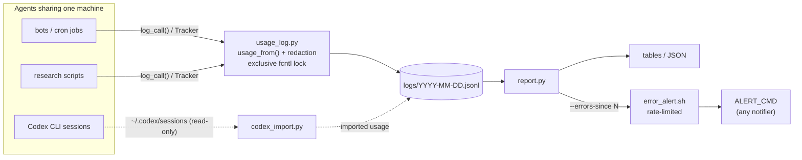

<div align="center">

# 📒 agent-usage-ledger

**A tiny, shared, per-agent ledger for LLM/API calls: who called what, how many tokens, what failed.**

[](https://github.com/sdpwh7-ux/agent-usage-ledger/actions/workflows/ci.yml)
[](LICENSE)
[](https://www.python.org/)
[](#-features)
[](#-security-model)

**English** | [简体中文](README.zh-CN.md) | [日本語](README.ja.md)

</div>

---

## 🤔 Why

When several agents (bots, cron jobs, Codex sessions, research scripts) share one machine and a handful of API keys, two questions get hard to answer:

- *"Where did the quota go?"*
- *"Which bot has been getting 429s all night?"*

Full observability platforms are too much for this. **agent-usage-ledger** answers both questions with almost no machinery. Each call becomes one JSON line in a daily file, written under a file lock, and plain reports run on top of that. It uses only the Python standard library. It has no network access and no daemon.

> It only **records** calls. It never retries, fails over, or switches providers.

## ✨ Features

- 🧾 **One function to log.** `log_call(...)` appends one JSON line per call to `logs/YYYY-MM-DD.jsonl`.
- 🔒 **Safe across processes and agents.** Each write takes an exclusive `fcntl` lock.
- 🌊 **Streaming support.** A `Tracker` adds up usage from streaming events and logs once.
- 🧠 **Understands common usage shapes.** `usage_from()` parses OpenAI Chat Completions, OpenAI Responses and Gemini usage, including reasoning and cached tokens.
- 🛡️ **Never raises, never stores keys.** Accounting must not break the caller. Error text is redacted and truncated.
- 📊 **Flexible reports.** `report.py` builds tables by agent × provider × model (or any grouping), with optional JSON output.
- 🚨 **Cron-friendly alerts.** `--errors-since N` prints only *new*, deduplicated errors. `error_alert.sh` rate-limits them and passes them to any notifier you choose.
- 🤖 **Codex CLI import.** `codex_import.py` reads token usage from `~/.codex/sessions` (read-only), so subscription usage shows up next to API usage.
- 🪶 **Zero dependencies.** Pure standard-library Python 3.9+. No network, no daemon.

## ⚙️ How it works



| Component | Role |
| --- | --- |
| `usage_log.py` | `log_call(...)`, `Tracker` and `usage_from()`. Appends locked JSONL records. Never raises. |
| `report.py` | Tables by agent × provider × model (or any grouping), JSON output, `--errors-since N` |
| `codex_import.py` | Imports Codex CLI token usage from `~/.codex/sessions` (read-only) |
| `error_alert.sh` | Rate-limited wrapper that passes new errors to any notifier |

## 🚀 Quick start

### Install

```bash
git clone https://github.com/sdpwh7-ux/agent-usage-ledger.git
export PYTHONPATH="$PWD/agent-usage-ledger:$PYTHONPATH"   # or copy usage_log.py next to your scripts
```

### Name your agent

Tell the ledger who is calling (once per agent/process):

```bash
export AGENT_NAME=research-bot
```

### Log a call

```python
import time
from usage_log import log_call, usage_from, Tracker

t0 = time.time(); resp = client_call(...)                  # your call, any SDK
ti, to, extra = usage_from(resp)                           # OpenAI chat / Responses / Gemini shapes
log_call("openai", "gpt-4o-mini", tokens_in=ti, tokens_out=to, ok=True, status=200,
         latency=time.time() - t0, endpoint="/chat/completions", **extra)

# streaming
tr = Tracker("openai", "my-model", "/v1/responses")
for ev in stream: tr.feed(ev)
tr.done(ok=True, status=200)
```

You can pass an optional `cost_hint={"usd": 0.004}` (or any numeric keys, such as `pages`), and the report sums it. See `examples/wrap_call.py` for a complete stdlib example.

### Reports

```bash
python3 report.py                                  # last 24h, agent x provider x model
python3 report.py --day 2026-10-18                 # one calendar day (local time)
python3 report.py --hours 6 --by provider,model --bot research --json
python3 report.py --errors-since 15                # new errors only; silent when none
```

```
# API usage, last 24h since 2026-10-21 09:00 -0400: 4 call(s)
bot          provider  model  calls  err  tok_in  tok_out  avg_s  cost_hint
-----------  --------  -----  -----  ---  ------  -------  -----  ---------
research-bot openai    m1         3    0     300       30    2.0
other        deepseek  m2         1    1       0        0      -
-----------  --------  -----  -----  ---  ------  -------  -----  ---------
TOTAL                             4    1     300       30
```

### Alerts from cron

By default you get at most one alert every 2 h and 3 per day. Errors that arrive in between are batched.

```cron
*/15 * * * * ALERT_CMD='notify-send "$TITLE" "$BODY"' /path/to/agent-usage-ledger/error_alert.sh
```

### Tests

```bash
python3 -m unittest discover -s tests -v
```

## 🔧 Configuration

| Variable | Default | Meaning |
| --- | --- | --- |
| `AGENT_NAME` | `unknown:<script>` | agent name recorded with each call |
| `AGENT_USAGE_DIR` | `~/.local/share/agent-usage` | ledger root (`logs/` inside) |
| `AGENT_USAGE_STATE` | `~/.local/state/agent-usage` | dedupe/import state |
| `AGENT_USAGE_LOG` | `1` | `0` disables logging |
| `AGENT_USAGE_KEY_FILES` | - | `:`-separated key files whose contents are scrubbed from errors |
| `AGENT_USAGE_SECRET_ENV` | common `*_API_KEY` names | env vars whose values are scrubbed |
| `CODEX_HOME` | `~/.codex` | where Codex CLI sessions live |
| `ALERT_CMD`, `ALERT_MIN_INTERVAL`, `ALERT_MAX_PER_DAY`, `ALERT_WINDOW_MIN` | - / 7200 / 3 / 180 | `error_alert.sh` |

**Record fields:** `ts id bot script provider model endpoint ok status tokens_in tokens_out cost_hint latency_s error pid`, plus extras (`reasoning_tokens`, `cached_tokens`, `resp_model`, `stream`, ...).

## 🔐 Security model

| Area | Guarantee |
| --- | --- |
| 🔑 **Credentials** | The ledger never asks for keys. To redact error text, it reads the env vars in `AGENT_USAGE_SECRET_ENV` and the files in `AGENT_USAGE_KEY_FILES` *in memory only*. It also masks `Bearer ...` and any token-like string of 32 or more characters. Redaction is best-effort, so do not log request bodies or prompts in `error`. |
| 📁 **Files** | Log files are created with mode 640 under your umask. They contain model names, token counts and (redacted) error text, but no prompts or outputs. Still, treat them as internal. |
| 🌐 **Network** | None. `report.py` and `codex_import.py` only read local files (`codex_import.py` reads `~/.codex/sessions/**` and writes only its own state file). |
| 🐚 **Shell** | `error_alert.sh` runs `ALERT_CMD` with `bash -c`. The error text is passed through the environment (`$BODY`) and is never interpolated into the command string. Quote `"$BODY"` in your command. |

## 🗺️ Project status & roadmap

**Newly open-sourced (2026).** The core pieces described above are implemented and covered by the unit test suite, which runs in CI. The project is young and the record format may still change based on feedback.

The ideas below are **not implemented yet**. Open an issue to discuss them:

- Parsers for more provider usage shapes in `usage_from()`
- More report groupings and output formats
- Wider testing across platforms and Python versions

Design principles we plan to keep: standard library only, no network, no daemon, and never break the caller.

## 🤝 Contributing

Issues and pull requests are welcome.

1. Fork the repo and create a branch.
2. Keep changes stdlib-only and free of network access.
3. Run the tests before opening a PR:

   ```bash
   python3 -m unittest discover -s tests -v
   ```

4. For new provider usage shapes, add a test with a sample (redacted) response.

## 📄 License

[MIT](LICENSE)

---

### 🧰 Part of the agent toolkit

| Repo | |
| --- | --- |
| [taskwake](https://github.com/sdpwh7-ux/taskwake) | |
| [agent-search-kit](https://github.com/sdpwh7-ux/agent-search-kit) | |
| [streamsafe](https://github.com/sdpwh7-ux/streamsafe) | |
| [agent-usage-ledger](https://github.com/sdpwh7-ux/agent-usage-ledger) | 📍 you are here |
| [git-box-sync](https://github.com/sdpwh7-ux/git-box-sync) | |
