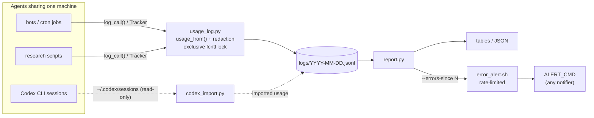

<div align="center">

# 📒 agent-usage-ledger

**一个轻量的共享账本，按智能体（agent）记录 LLM/API 调用：谁调用了什么、用了多少 token、哪些调用失败了。**

[](https://github.com/sdpwh7-ux/agent-usage-ledger/actions/workflows/ci.yml)
[](LICENSE)
[](https://www.python.org/)
[](#-功能特性)
[](#-安全模型)

[English](README.md) | **简体中文** | [日本語](README.ja.md)

</div>

---

## 🤔 为什么需要它

当多个智能体（机器人、cron 任务、Codex 会话、研究脚本）共用一台机器和少数几个 API key 时，有两个问题会变得很难回答：

- *“配额都用到哪里去了？”*
- *“哪个机器人整晚都在收到 429？”*

为此搭建完整的可观测性平台没有必要。**agent-usage-ledger** 几乎不需要额外设施就能回答这两个问题：每次调用写成每日文件中的一行 JSON，写入时加文件锁，再在此基础上生成简单的报表。它只使用 Python 标准库，不访问网络，也不需要常驻进程。

> 它只**记录**调用，从不重试、故障转移或切换服务商。

## ✨ 功能特性

- 🧾 **一个函数完成记录**：`log_call(...)` 每次调用向 `logs/YYYY-MM-DD.jsonl` 追加一行 JSON。
- 🔒 **跨进程、跨智能体安全**：每次写入都持有排他的 `fcntl` 锁。
- 🌊 **支持流式响应**：`Tracker` 汇总流式事件中的用量，最后只记录一次。
- 🧠 **识别常见用量格式**：`usage_from()` 能解析 OpenAI Chat Completions、OpenAI Responses 和 Gemini 的用量，包括 reasoning 和 cached token。
- 🛡️ **从不抛异常，从不保存密钥**：记账不能影响调用方。错误文本会先脱敏再截断。
- 📊 **灵活的报表**：`report.py` 按 智能体 × 服务商 × 模型（或任意分组）生成表格，也可以输出 JSON。
- 🚨 **适合 cron 告警**：`--errors-since N` 只输出*新的*、去重后的错误。`error_alert.sh` 对其限流，再交给你选择的任意通知工具。
- 🤖 **导入 Codex CLI 用量**：`codex_import.py` 从 `~/.codex/sessions` 读取 token 用量（只读），让订阅用量和 API 用量显示在一起。
- 🪶 **零依赖**：纯标准库 Python 3.9+，不访问网络，不需要常驻进程。

## ⚙️ 工作原理



| 组件 | 作用 |
| --- | --- |
| `usage_log.py` | 提供 `log_call(...)`、`Tracker` 和 `usage_from()`，在加锁状态下追加 JSONL 记录，从不抛异常 |
| `report.py` | 按 智能体 × 服务商 × 模型（或任意分组）生成表格，支持 JSON 输出和 `--errors-since N` |
| `codex_import.py` | 从 `~/.codex/sessions` 导入 Codex CLI 的 token 用量（只读） |
| `error_alert.sh` | 带限流的包装脚本，把新错误交给任意通知工具 |

## 🚀 快速开始

### 安装

```bash
git clone https://github.com/sdpwh7-ux/agent-usage-ledger.git
export PYTHONPATH="$PWD/agent-usage-ledger:$PYTHONPATH"   # or copy usage_log.py next to your scripts
```

### 设置智能体名称

告诉账本是谁在调用（每个智能体/进程设置一次）：

```bash
export AGENT_NAME=research-bot
```

### 记录一次调用

```python
import time
from usage_log import log_call, usage_from, Tracker

t0 = time.time(); resp = client_call(...)                  # your call, any SDK
ti, to, extra = usage_from(resp)                           # OpenAI chat / Responses / Gemini shapes
log_call("openai", "gpt-4o-mini", tokens_in=ti, tokens_out=to, ok=True, status=200,
         latency=time.time() - t0, endpoint="/chat/completions", **extra)

# streaming
tr = Tracker("openai", "my-model", "/v1/responses")
for ev in stream: tr.feed(ev)
tr.done(ok=True, status=200)
```

可以选择传入 `cost_hint={"usd": 0.004}`（或任意数值型键，例如 `pages`），报表会对其求和。完整的标准库示例见 `examples/wrap_call.py`。

### 报表

```bash
python3 report.py                                  # last 24h, agent x provider x model
python3 report.py --day 2026-10-18                 # one calendar day (local time)
python3 report.py --hours 6 --by provider,model --bot research --json
python3 report.py --errors-since 15                # new errors only; silent when none
```

```
# API usage, last 24h since 2026-10-21 09:00 -0400: 4 call(s)
bot          provider  model  calls  err  tok_in  tok_out  avg_s  cost_hint
-----------  --------  -----  -----  ---  ------  -------  -----  ---------
research-bot openai    m1         3    0     300       30    2.0
other        deepseek  m2         1    1       0        0      -
-----------  --------  -----  -----  ---  ------  -------  -----  ---------
TOTAL                             4    1     300       30
```

### 通过 cron 告警

默认每 2 小时最多一条、每天最多 3 条告警，期间出现的错误会合并发送。

```cron
*/15 * * * * ALERT_CMD='notify-send "$TITLE" "$BODY"' /path/to/agent-usage-ledger/error_alert.sh
```

### 测试

```bash
python3 -m unittest discover -s tests -v
```

## 🔧 配置

| 变量 | 默认值 | 含义 |
| --- | --- | --- |
| `AGENT_NAME` | `unknown:<script>` | 每次调用记录的智能体名称 |
| `AGENT_USAGE_DIR` | `~/.local/share/agent-usage` | 账本根目录（其中包含 `logs/`） |
| `AGENT_USAGE_STATE` | `~/.local/state/agent-usage` | 去重/导入状态 |
| `AGENT_USAGE_LOG` | `1` | 设为 `0` 时关闭记录 |
| `AGENT_USAGE_KEY_FILES` | - | 以 `:` 分隔的密钥文件，其内容会从错误文本中清除 |
| `AGENT_USAGE_SECRET_ENV` | 常见的 `*_API_KEY` 名称 | 这些环境变量的值会被清除 |
| `CODEX_HOME` | `~/.codex` | Codex CLI 会话所在目录 |
| `ALERT_CMD`, `ALERT_MIN_INTERVAL`, `ALERT_MAX_PER_DAY`, `ALERT_WINDOW_MIN` | - / 7200 / 3 / 180 | `error_alert.sh` |

**记录字段：** `ts id bot script provider model endpoint ok status tokens_in tokens_out cost_hint latency_s error pid`，以及附加字段（`reasoning_tokens`、`cached_tokens`、`resp_model`、`stream` 等）。

## 🔐 安全模型

| 方面 | 保证 |
| --- | --- |
| 🔑 **凭据** | 账本从不索要密钥。为了给错误文本脱敏，它*只在内存中*读取 `AGENT_USAGE_SECRET_ENV` 中的环境变量和 `AGENT_USAGE_KEY_FILES` 中的文件。此外还会屏蔽 `Bearer ...` 以及任何 32 个字符及以上、形似 token 的字符串。脱敏只是尽力而为，请不要在 `error` 中记录请求体或提示词。 |
| 📁 **文件** | 日志文件按你的 umask 以 640 权限创建，内容包括模型名称、token 数量和（已脱敏的）错误文本，不含提示词或输出。即便如此，也请把它们当作内部文件对待。 |
| 🌐 **网络** | 无。`report.py` 和 `codex_import.py` 只读取本地文件（`codex_import.py` 读取 `~/.codex/sessions/**`，只写入它自己的状态文件）。 |
| 🐚 **Shell** | `error_alert.sh` 通过 `bash -c` 运行 `ALERT_CMD`。错误文本通过环境变量（`$BODY`）传递，从不插入到命令字符串中。请在你的命令中给 `"$BODY"` 加上引号。 |

## 🗺️ 项目状态与路线图

**新近开源（2026 年）。** 上述核心组件均已实现，并有单元测试覆盖，测试在 CI 中运行。项目仍处于早期，记录格式可能会根据反馈调整。

以下想法**尚未实现**，欢迎开 issue 讨论：

- 在 `usage_from()` 中支持更多服务商的用量格式
- 更多报表分组和输出格式
- 在更多平台和 Python 版本上进行测试

计划长期保持的设计原则：只用标准库、不访问网络、不需要常驻进程、绝不影响调用方。

## 🤝 参与贡献

欢迎提交 issue 和 pull request。

1. Fork 仓库并创建分支。
2. 保持只依赖标准库，不访问网络。
3. 提交 PR 前运行测试：

   ```bash
   python3 -m unittest discover -s tests -v
   ```

4. 新增服务商用量格式时，请附上包含（已脱敏）示例响应的测试。

## 📄 许可证

[MIT](LICENSE)

---

### 🧰 智能体工具集（agent toolkit）成员

| 仓库 | |
| --- | --- |
| [taskwake](https://github.com/sdpwh7-ux/taskwake) | |
| [agent-search-kit](https://github.com/sdpwh7-ux/agent-search-kit) | |
| [streamsafe](https://github.com/sdpwh7-ux/streamsafe) | |
| [agent-usage-ledger](https://github.com/sdpwh7-ux/agent-usage-ledger) | 📍 当前仓库 |
| [git-box-sync](https://github.com/sdpwh7-ux/git-box-sync) | |
